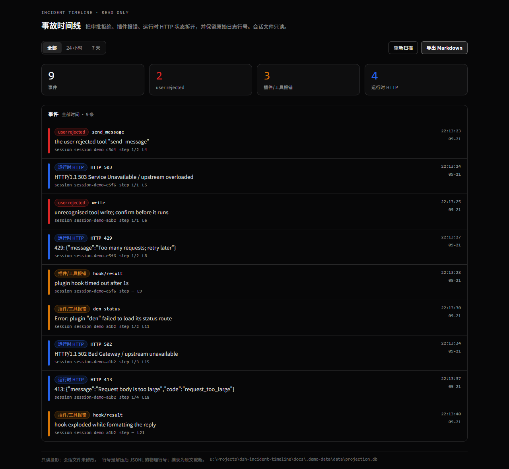

# dsh-incident-timeline

[](https://github.com/dingchenhui0618-arch/dsh-incident-timeline/actions/workflows/ci.yml)
[](LICENSE)

给 DeepSeek Harness 的会话日志加一层**只读事故时间线**：把 `user rejected`、插件/工具报错、运行时 HTTP 状态分成三类，导出成带**会话 id、步号、原始日志行号、原文摘录**的可引用 Markdown 表格，并支持只对某一时间窗生成。

会话文件只读，插件自己的写入只落在投影库 `projection.db`。



## 它补的是哪一段

灵感来自 [drscrewdriver/dsh-reference-session-collector](https://github.com/drscrewdriver/dsh-reference-session-collector)（DRSC）。DRSC 做到了「解码会话日志 → 结构化进 SQLite（segments / replacements / FTS5）」，但事故复盘还需要再往前一步：**按事故类型归并，并且每条都能回到原始日志行**。

本项目独立实现，不是 fork，也没有复制 DRSC 的代码。定位对比：

| | DRSC | dsh-incident-timeline |
|---|---|---|
| 会话日志 → SQLite 投影 | 有 | 有（为事故时间线收窄的 schema） |
| 多帧 zstd 解码 | 有 | 有，独立实现 |
| segments / replacements | 有 | 有（turn/step 行区间、compaction shadow 区间） |
| FTS5 / tokenizer / surface / recall | 有 | **不做** |
| 三类事故标签 | 无 | **有**：`user-rejected` / `plugin-error` / `runtime-http` |
| 带物理行号的可引用导出 | 无 | **有**：Markdown 表格 + JSON |
| 时间窗过滤 | 有（turn 区间等） | **有**：`--since` / `--until`，UI 内置 24h / 7d |
| 只读纪律 | 有 | 有（测试里校验会话文件 hash/mtime 不变） |

DRSC 是通用的会话投影与检索底座；这个项目是事故复盘专用的一层。两者可以并存，也欢迎把这里的分类规则接回 DRSC 的查询面。

## 为什么不是「一句授权问题就结案」

DSH 的会话日志里，这三件事长得很像，但根因完全不同：

- **user rejected**：审批被拒。证据是 `approval/decided{outcome:"rejected"}`，或者日志里只留下的 `tool/result` 文本 `the user rejected tool "..."`。
- **plugin-error**：工具 / 插件 / hook / 命令 / 模型流报错，但**不是**用户拒绝，也**不是**显式 HTTP 状态。
- **runtime-http**：失败信息里出现明确的 4xx/5xx，例如 `413: {"message":"Request body is too large"}`、`HTTP/1.1 503 Service Unavailable`、`status code: 429`。

把它们混成一类，就会把「审批被拒」误判成「插件坏了」，或者把「网关 413」误判成「用户不授权」。本工具的第一原则是**分开**；第二原则是每条都带原始行号。

## 安装

```sh
dsh plugin --profile <你的 profile> add dsh-incident-timeline
```

也可以直接从 GitHub 装：

```sh
dsh plugin --profile <你的 profile> add github:dingchenhui0618-arch/dsh-incident-timeline
```

要求 Node ≥ 22.16（`node:sqlite` 与 `zlib.zstdDecompressSync`），DSH `>=0.2.1-rc.2 <0.3.0`。零运行时依赖。

装好后，对话视图出现「事故时间线」Tab。面板第一次打开时会扫描 `$DSH_HOME/sessions`，之后按 30 秒新鲜度缓存；点「重新扫描」强制刷新。

## 命令行

不装插件也能用：

```sh
# 全部时间，输出 Markdown
node bin/incident-timeline.mjs scan --out incident.md

# 只看某一天，且只要审批拒绝
node bin/incident-timeline.mjs scan \
  --since 2026-11-16T00:00:00Z --until 2026-11-17T00:00:00Z \
  --kind user-rejected --out rejected.md

# 机器可读
node bin/incident-timeline.mjs scan --format json --quiet > timeline.json
```

常用参数：

| 参数 | 说明 |
|---|---|
| `--sessions-root <dir>` | 会话根目录（默认 `$DSH_HOME/sessions`） |
| `--db <file>` | 投影库（默认 `$DSH_HOME/incident-timeline/projection.db`） |
| `--out <file>` | 输出文件；缺省 stdout |
| `--format md\|json` | 输出格式 |
| `--since` / `--until` | ISO 时间或毫秒时间戳，闭区间 |
| `--kind` | 逗号分隔的三个标签 |
| `--session` | 只看某个会话 |
| `--limit` | 最多导出条数（1..5000） |
| `--max-session-mb` | 单个压缩会话上限（默认 64 MB） |
| `--force` / `--prune` / `--no-sync` / `--quiet` | 同步控制 |

Markdown 列固定为：

```
| 标签 | 会话 id | 步号 | 原始日志行号 | 时间（UTC） | 对象 | 原文摘录 |
```

行号是**解压后 JSONL 的物理行号**（空行也占行号），不是 `seq`。JSON 导出同时保留 `seq`、`turn`、`step`、`detail`，方便二次处理。

## HTTP 路由

单条 fenced 路由，前缀 `/dsh-incident-timeline`。它和 DSH 自己的 `/api` 走同一道浏览器信任栅栏（`ctx.connection.requestRejection`）：`Host` / `Origin` 不是这台 DSH 的返回 **403**，没有浏览器会话 cookie 返回 **401**——浏览器里随便打开的一个网页调不动它。

| 方法 | 路径 | 用途 |
|---|---|---|
| `GET` | `/state?since=&until=&kinds=&session=&limit=` | 面板数据（事件、计数、会话列表、上次同步） |
| `POST` | `/sync` | 强制全量重扫 |
| `GET` | `/export?format=md\|json&...` | 导出；`download=1` 带附件头 |
| `GET` | `/preview` | 无插件的独立预览页（与面板同一份 CSS/接口） |

示例（`dsh-auth-*` cookie 从浏览器 DevTools → Application → Cookies 里复制，有效期 30 天）：

```sh
curl -b 'dsh-auth-XXXXXXXXXXXXXXXX=v1.…' \
  'http://127.0.0.1:3080/dsh-incident-timeline/export?format=md&since=2026-11-16T00:00:00Z'
```

`/state` 的 `stats` 是**整个时间窗**的计数；`events` 受 `limit` 限制，所以列表截断时总数仍然正确。

## 只读纪律

- 扫描只调用 `readdir` / `stat` / `readFile`，不写任何会话文件。
- 唯一写入是插件自己的 `projection.db`（WAL 模式），路径可配置。
- 测试 `test/project.test.mjs` 会在同步前后比对会话文件的 SHA-256、mtime 和目录内容。
- 不读取、不导出 `~/.dsh` 下的凭据、插件配置或其它本机文件；只扫 `$DSH_HOME/sessions`。

## 已知边界

- **不是安全边界。** 它只做证据归并，不防止恶意代码，也不替代审批。
- **分类是启发式的。** `plugin-error` 覆盖工具/插件/hook/模型流错误；`runtime-http` 只认明确的 HTTP/status 形状。`532: row["file"]` 这种 grep 行号不会被当成 HTTP 状态。摘录是原文截断，未做语义改写。
- **超大会话会跳过。** 本机曾出现 211 MB 压缩、解压后超过 V8 字符串上限的会话；默认 64 MB 以上直接跳过并在同步结果里报告，不会把它投影成「没有事件」。可用 `--max-session-mb` 调整。
- **不处理日志轮转。** 目前发现的是 `session.v*.jsonl.zstd` / `.jsonl`；删除会话后默认保留投影，`--prune` 显式清理。
- **导出含会话原文。** 事故报告可能包含路径、命令输出或业务数据；分享前请自行审阅。

## 架构

```
$DSH_HOME/sessions/**（只读）
  └─ 多帧 zstd（每批追加一帧）
       └─ decode.js      逐帧边界扫描 → zlib 解压 → 物理行号
            └─ scan.js    JSONL 解析、超限保护
                 └─ timeline.js  三类标签 + 行号 + 摘录 + 时间窗
                      ├─ project.js  SQLite：sessions / records / segments / replacements / timeline_events
                      ├─ markdown.js 可引用 Markdown / JSON
                      └─ host.js     /state /sync /export /preview
                           └─ client.cjs  对话视图「事故时间线」Tab
```

## 开发

```sh
node scripts/build.mjs   # 零依赖构建，产出 lib/
node --test              # 50 个测试
node scripts/demo-server.mjs  # 合成数据预览，http://127.0.0.1:4317/dsh-incident-timeline/preview
```

测试分组：

- `decode`：多帧 zstd、skippable frame、截断、尾随垃圾、字节上限
- `timeline`：三类标签、去重、嵌套 tool-result、HTTP 提取、时间窗
- `project`：SQLite 投影、幂等、只读 hash/mtime、prune、超大跳过
- `markdown`：列、转义、空表、JSON、确定性
- `host`：路由、时间窗校验、导出、卸载
- `cli`：参数、输出文件、退出码

`lib/` 是入库的构建产物；改 `src/` 后必须重新 build。CI 会验证 `lib/` 与 `src/` 一致。

## License

MIT
